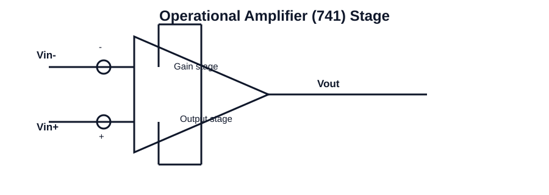

# 101 - The 741 IC Op-Amp: introduction, types of integrated circuits

## Navigation
- Previous: [Unit overview](./README.md)
- Next: [102 - General operational amplifier stages](./102-general-operational-amplifier-stages.md)
- Related topics: [102 - General operational amplifier stages](102-general-operational-amplifier-stages.md), [103 - Bias circuit](103-bias-circuit.md)

## Unit
Unit-I

## Overview
The 741 op-amp is the classic general-purpose operational amplifier widely used in analog electronics. It is a bipolar integrated circuit designed using differential input stages, gain stages, and an output stage. This topic introduces integrated circuits, the difference between analog and digital ICs, and the significance of the 741 in circuit design. Students should understand the internal architecture, device operation, and practical role of the 741 in inverting, non-inverting, and comparator applications.

Key ideas to remember:
- Integrated circuits combine multiple electronic components on one chip.
- The 741 is a monolithic op-amp used for amplification and signal processing.
- Internal stages include input differential pair, gain stage, and output stage.
- Its performance depends on gain, bandwidth, input impedance, output drive, and slew rate.
- The 741 forms the foundation for many linear circuits and applications.

## Circuit Diagram

## Link
https://youtu.be/ov1TF34Wnpw?si=jFG_f3cXeFSfkkDS

## Notes
### Concept
An operational amplifier is a high-gain differential amplifier used to amplify small signals and perform analog signal processing. The topic explains the internal stages, operating conditions, and performance limitations that govern circuit behavior in practical IC designs.

### Working principle
- Identify the differential input, gain stage, and output stage of the amplifier.
- Relate signal gain to input-output behavior and explain the effect of feedback.
- Interpret key parameters such as gain, bandwidth, CMRR, slew rate, and offset.

### Important points
- Understand the physical behavior of the circuit or element.
- Connect the concept to a real-world application.
- Use the relevant equations for numerical problem solving.

### Applications
- Signal amplification
- Instrumentation and sensing
- Active filters and oscillators

### Related circuits
- Differential input stage
- Inverting amplifier
- Non-inverting amplifier
- Comparator circuit
- Feedback network

### Key equations
- Voltage gain: Av = Vout / Vin
- Inverting gain: Av = -Rf / Rin
- Non-inverting gain: Av = 1 + Rf / Rin
- Slew rate: SR = dVout / dt |max
- CMRR = Ad / Acm

### Exam focus
- Explain the basic working principle using a circuit diagram or block diagram.
- List the important parameters and their significance.
- Solve numerical problems involving gain, frequency response, timing, or component values.
- Connect the concept to an engineering application in analog or digital electronics.
