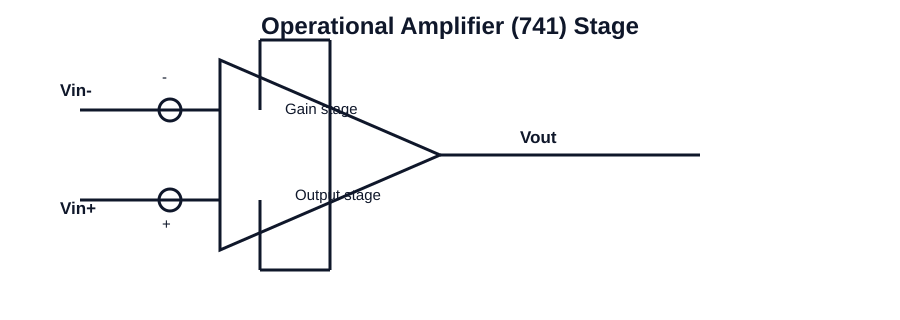

# 110 - Op-amp device parameters

## Navigation
- Previous: [109 - Equivalent model of op-amp](./109-equivalent-model-of-op-amp.md)
- Next: [111 - Voltage gain, differential gain, common mode gain, CMRR](./111-voltage-gain-differential-gain-common-mode-gain-cmrr.md)
- Related topics: [109 - Equivalent model of op-amp](109-equivalent-model-of-op-amp.md), [111 - Voltage gain, differential gain, common mode gain, CMRR](111-voltage-gain-differential-gain-common-mode-gain-cmrr.md), [101 - The 741 IC Op-Amp: introduction, types of integrated circuits](101-the-741-ic-op-amp-introduction-types-of-integrated-circuits.md), [112 - Input bias current, input offset current, power supply rejection ratio, frequency response of 741](112-input-bias-current-input-offset-current-power-supply-rejection-ratio-frequency-response-of-741.md)

## Unit
Unit-I

## Overview
This topic focuses on op amp device parameters in integrated circuits. It is an important concept in analog circuit analysis and design because it connects device behavior with practical amplifier and signal-processing applications.

Students should understand the basic operating principle, the role of the circuit in the wider system, and the key parameters that affect performance such as gain, bandwidth, stability, linearity, and efficiency.

In practical engineering work, this topic helps explain how circuit blocks are designed, analyzed, and used for real applications in operational amplifiers, filters, oscillators, and digital logic.

Key points to remember include the physical meaning of the concept, the mathematical relationships involved, and the relationship between theory and circuit behavior in real ICs.

## Circuit Diagram

## Link
https://youtu.be/r6zfYXGk3PY?si=JYgyD3nHCOpKnkgI

## Notes
### Concept
An operational amplifier is a high-gain differential amplifier used to amplify small signals and perform analog signal processing. The topic explains the internal stages, operating conditions, and performance limitations that govern circuit behavior in practical IC designs.

### Working principle
- Identify the differential input, gain stage, and output stage of the amplifier.
- Relate signal gain to input-output behavior and explain the effect of feedback.
- Interpret key parameters such as gain, bandwidth, CMRR, slew rate, and offset.

### Important points
- Understand the physical behavior of the circuit or element.
- Connect the concept to a real-world application.
- Use the relevant equations for numerical problem solving.

### Applications
- Signal amplification
- Instrumentation and sensing
- Active filters and oscillators

### Key equations
- Voltage gain: Av = Vout / Vin
- Inverting gain: Av = -Rf / Rin
- Non-inverting gain: Av = 1 + Rf / Rin
- Slew rate: SR = dVout / dt |max
- CMRR = Ad / Acm

### Exam focus
- Explain the basic working principle using a circuit diagram or block diagram.
- List the important parameters and their significance.
- Solve numerical problems involving gain, frequency response, timing, or component values.
- Connect the concept to an engineering application in analog or digital electronics.
