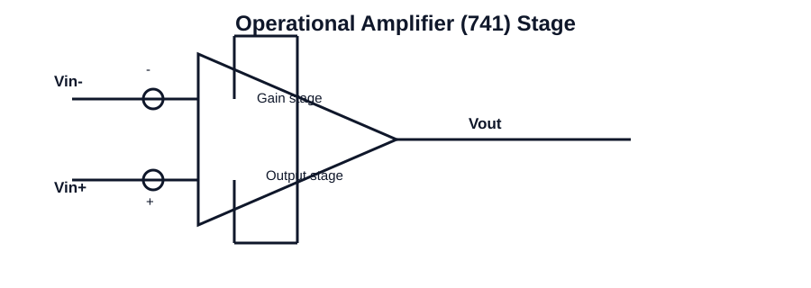

# 202 - Numerical practice problem 1

## Navigation
- Previous: [201 - Op-Amp based V-I converters or transconductance amplifier or voltage dependent current source](./201-op-amp-based-v-i-converters-or-transconductance-amplifier-or-voltage-dependent-current-source.md)
- Next: [203 - Op-Amp based I-V converters](./203-op-amp-based-i-v-converters.md)
- Related topics: [201 - Op-Amp based V-I converters or transconductance amplifier or voltage dependent current source](201-op-amp-based-v-i-converters-or-transconductance-amplifier-or-voltage-dependent-current-source.md), [203 - Op-Amp based I-V converters](203-op-amp-based-i-v-converters.md), [201 - Op-Amp based V-I converters or transconductance amplifier or voltage dependent current source](201-op-amp-based-v-i-converters-or-transconductance-amplifier-or-voltage-dependent-current-source.md), [204 - Difference amplifier](204-difference-amplifier.md)

## Unit
Unit-II

## Overview
This topic focuses on numerical practice problem 1 in integrated circuits. It is an important concept in analog circuit analysis and design because it connects device behavior with practical amplifier and signal-processing applications.

Students should understand the basic operating principle, the role of the circuit in the wider system, and the key parameters that affect performance such as gain, bandwidth, stability, linearity, and efficiency.

In practical engineering work, this topic helps explain how circuit blocks are designed, analyzed, and used for real applications in operational amplifiers, filters, oscillators, and digital logic.

Key points to remember include the physical meaning of the concept, the mathematical relationships involved, and the relationship between theory and circuit behavior in real ICs.

## Circuit Diagram

## Link
https://www.youtube.com/live/5vIqPVD52qw?si=NhYbqeH6cT_AwtGK

## Notes
### Concept
This topic is a core building block in analog and digital IC design. It explains the underlying principle, circuit implementation, and practical relevance of the concept in modern electronics.

### Working principle
- Understand the core physical principle behind the topic.
- Relate the circuit or concept to a practical signal-processing application.
- Validate the concept using equations, waveforms, or expected operating conditions.

### Important points
- Understand the physical behavior of the circuit or element.
- Connect the concept to a real-world application.
- Use the relevant equations for numerical problem solving.

### Applications
- Analog signal design
- Circuit analysis
- Practical electronics

### Key equations
- Use the proper device model and transfer equation for the circuit.
- Apply KCL/KVL to analyze the circuit quantitatively.
- Relate the equation to practical waveform or output behavior.

### Exam focus
- Explain the basic working principle using a circuit diagram or block diagram.
- List the important parameters and their significance.
- Solve numerical problems involving gain, frequency response, timing, or component values.
- Connect the concept to an engineering application in analog or digital electronics.
