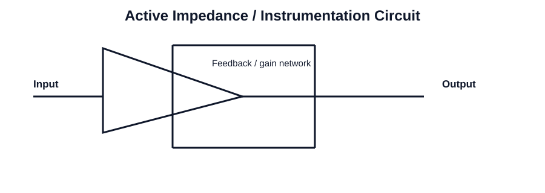

# 210 - Generalized impedance converter

## Navigation
- Previous: [209 - Ideal current and voltage sources using negative resistance](./209-ideal-current-and-voltage-sources-using-negative-resistance.md)
- Next: [211 - Simulation of inductors](./211-simulation-of-inductors.md)
- Related topics: [209 - Ideal current and voltage sources using negative resistance](209-ideal-current-and-voltage-sources-using-negative-resistance.md), [211 - Simulation of inductors](211-simulation-of-inductors.md), [201 - Op-Amp based V-I converters or transconductance amplifier or voltage dependent current source](201-op-amp-based-v-i-converters-or-transconductance-amplifier-or-voltage-dependent-current-source.md), [212 - Passive first-order low pass filter](212-passive-first-order-low-pass-filter.md)

## Unit
Unit-II

## Overview
This topic focuses on generalized impedance converter in integrated circuits. It is an important concept in analog circuit analysis and design because it connects device behavior with practical amplifier and signal-processing applications.

Students should understand the basic operating principle, the role of the circuit in the wider system, and the key parameters that affect performance such as gain, bandwidth, stability, linearity, and efficiency.

In practical engineering work, this topic helps explain how circuit blocks are designed, analyzed, and used for real applications in operational amplifiers, filters, oscillators, and digital logic.

Key points to remember include the physical meaning of the concept, the mathematical relationships involved, and the relationship between theory and circuit behavior in real ICs.

## Circuit Diagram

## Link
https://www.youtube.com/live/OyGvj18pmAc?si=cOmcEb1LUp6vfqBO

## Notes
### Concept
This topic studies active impedance synthesis and reactive network behavior using op-amp-based circuits. Such circuits emulate inductive or frequency-dependent elements without discrete inductors.

### Working principle
- Replace a reactive element with an active equivalent using op-amp feedback and impedance synthesis.
- Interpret the effect of active synthesis on frequency-dependent behavior.
- Use the concept in filter and signal-processing applications.

### Important points
- Understand the physical behavior of the circuit or element.
- Connect the concept to a real-world application.
- Use the relevant equations for numerical problem solving.

### Applications
- Active filter realization
- Reactive element emulation
- RF and signal processing

### Key equations
- Z = V / I
- For an inductor emulator, reactance is frequency dependent
- Negative resistance condition: R < 0 for active network
- Q and resonance frequency define reactive behavior

### Exam focus
- Explain the basic working principle using a circuit diagram or block diagram.
- List the important parameters and their significance.
- Solve numerical problems involving gain, frequency response, timing, or component values.
- Connect the concept to an engineering application in analog or digital electronics.
