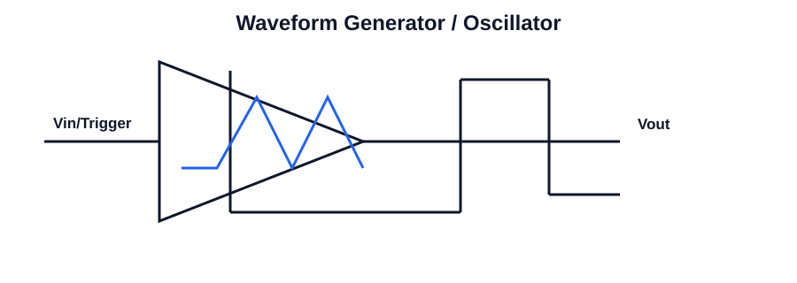

# 314 - Astable multivibrator

## Navigation
- Previous: [313 - Schmitt trigger](./313-schmitt-trigger.md)
- Next: [315 - Monostable multivibrator](./315-monostable-multivibrator.md)
- Related topics: [313 - Schmitt trigger](313-schmitt-trigger.md), [315 - Monostable multivibrator](315-monostable-multivibrator.md), [301 - Frequency compensation](301-frequency-compensation.md), [316 - Generation of square waveforms](316-generation-of-square-waveforms.md)

## Unit
Unit-III

## Overview
This topic focuses on astable multivibrator in integrated circuits. It is an important concept in analog circuit analysis and design because it connects device behavior with practical amplifier and signal-processing applications.

Students should understand the basic operating principle, the role of the circuit in the wider system, and the key parameters that affect performance such as gain, bandwidth, stability, linearity, and efficiency.

In practical engineering work, this topic helps explain how circuit blocks are designed, analyzed, and used for real applications in operational amplifiers, filters, oscillators, and digital logic.

Key points to remember include the physical meaning of the concept, the mathematical relationships involved, and the relationship between theory and circuit behavior in real ICs.

## Circuit Diagram

## Link
https://www.youtube.com/live/bVItmFjMpxw?si=3AH-mo6Nmh2-Xj2d

## Notes
### Concept
This topic deals with switching and waveform-generation circuits used to convert analog signals into controlled digital-like transitions. These circuits are used for timing, shaping, triggering, and waveform generation in electronic systems.

### Working principle
- Analyse the trigger and threshold conditions that switch the output state.
- Understand hysteresis, timing capacitor behavior, and state transitions.
- Connect the circuit to waveform generation, pulse shaping, and timing control.

### Important points
- Threshold conditions determine switching states
- Hysteresis improves noise immunity in Schmitt trigger circuits
- Charging and discharging of capacitors control timing and waveform frequency.

### Applications
- Pulse generation
- Wave shaping
- Triggering and timing

### Key equations
- Time constant: τ = RC
- Frequency of astable oscillator: f ≈ 1 / (0.693 RC)
- Threshold hysteresis: VTH+ - VTH- = hysteresis width
- Period: T = 2.2 RC for one-shot application

### Exam focus
- Explain the basic working principle using a circuit diagram or block diagram.
- List the important parameters and their significance.
- Solve numerical problems involving gain, frequency response, timing, or component values.
- Connect the concept to an engineering application in analog or digital electronics.
