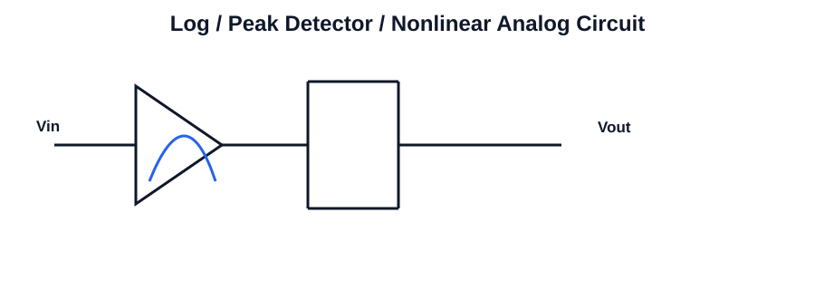

# 319 - Analog multipliers and their applications

## Navigation
- Previous: [318 - Frequency of generated triangular waveform](./318-frequency-of-generated-triangular-waveform.md)
- Next: [Unit overview](./README.md)
- Related topics: [318 - Frequency of generated triangular waveform](318-frequency-of-generated-triangular-waveform.md), [301 - Frequency compensation](301-frequency-compensation.md)

## Unit
Unit-III

## Overview
This topic focuses on analog multipliers and their applications in integrated circuits. It is an important concept in analog circuit analysis and design because it connects device behavior with practical amplifier and signal-processing applications.

Students should understand the basic operating principle, the role of the circuit in the wider system, and the key parameters that affect performance such as gain, bandwidth, stability, linearity, and efficiency.

In practical engineering work, this topic helps explain how circuit blocks are designed, analyzed, and used for real applications in operational amplifiers, filters, oscillators, and digital logic.

Key points to remember include the physical meaning of the concept, the mathematical relationships involved, and the relationship between theory and circuit behavior in real ICs.

## Circuit Diagram

## Link
https://youtu.be/papMcmgUnaM?si=HY366qA_F3KxTrtp

## Notes
### Concept
This topic explores nonlinear analog circuits that process signals by using exponential, logarithmic, switching, and storage behaviors. These circuits are used in instrumentation, waveform shaping, and analog computation.

### Working principle
- Study the nonlinear transfer characteristic used for logarithmic or signal-processing analog functions.
- Identify the role of active devices and feedback in shaping the transfer curve.
- Connect the circuit to measurement, modulation, and analog computation tasks.

### Important points
- Nonlinear transfer functions are useful for analog computation and measurement
- Temperature compensation is important for log/antilog accuracy
- Peak detectors and sample-hold circuits preserve signal amplitude or value.

### Applications
- Analog computation
- Detection circuits
- Data acquisition systems

### Related circuits
- Log amplifier using BJT
- Log amplifier using diode
- Peak detector
- Sample-and-hold circuit
- Analog multiplier core

### Key equations
- Log relation: Vout = -nVT ln(Vin / I0R)
- Peak detector output tracks maximum input value over time
- Sample-and-hold retains value during hold phase
- Multiplier output is proportional to product of two inputs

### Exam focus
- Explain the basic working principle using a circuit diagram or block diagram.
- List the important parameters and their significance.
- Solve numerical problems involving gain, frequency response, timing, or component values.
- Connect the concept to an engineering application in analog or digital electronics.
